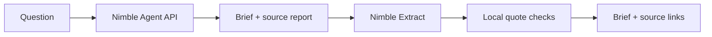

   

# Proof

A research agent that shows its sources. One API key: Nimble.

Nimble's Agent API researches the question and returns a brief with citations. Proof reads the cited pages through Nimble Extract and checks that each quote appears in the retrieved text.

## Run

Python 3.9 or newer. No dependencies to install.

```sh
git clone https://github.com/ojusave/nimble-proof-agent.git
cd nimble-proof-agent
cp .env.example .env
```

Add `NIMBLE_API_KEY` to `.env`, then start:

```sh
python3 app.py serve
```

Open http://127.0.0.1:8765. Or use the CLI:

```sh
python3 app.py run 'Compare Snowflake and Databricks private networking options.' --output data/brief.md
```

**Try demo** works without a key. It uses fictional data and a scripted model, not live research.

## How it works



Python starts the remote run and polls its status. Each finding must cite a URL in Nimble's source report and quote text found in a fresh extraction. SQLite saves history; the browser shows progress and exports Markdown.

A matching quote proves where the text came from. It does not prove the claim is true. Pages can also change between research and verification, causing a quote check to fail.

Live runs use paid Nimble credits. The app uses low effort and waits up to five minutes before fetching the final result. A timed-out remote run may continue; its agent and run IDs appear in the activity log. Creation requests are not automatically retried to avoid duplicate paid runs. Narrow your question to control cost.

Your questions and cited URLs are sent to Nimble. Keys stay server-side; `.env` and local history are excluded from Git. The server binds to localhost and is intended for local use.

## Tests

```sh
python3 -m unittest discover -s tests -v
python3 app.py run --demo
```

Tests cover the hosted run lifecycle, source-report checks, quote validation, failures, timeouts, and local HTTP endpoints. The demo's local tool loop is tested separately. A live Agent API run and subsequent Extract checks were also verified locally.

[Sample output](examples/synthetic-brief.md) · [Design notes](docs/design.md) · [Demo walkthrough](docs/demo.md)

API references: [Nimble Agent API](https://docs.nimbleway.com/nimble-sdk/web-search-agents/quickstart), [Nimble Extract](https://docs.nimbleway.com/api-reference/extract/extract).

[MIT license](LICENSE)
