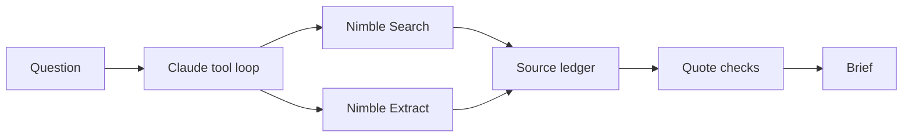

    

# Proof

A research agent that shows its sources.

Ask a technical question. Claude decides what to search and read using Nimble. Each finding includes a quote and source link. The app rejects quotes it cannot find in the retrieved page.

## Run

Python 3.9 or newer. No dependencies to install.

```sh
git clone https://github.com/ojusave/nimble-proof-agent.git
cd nimble-proof-agent
python3 app.py serve
```

Open http://127.0.0.1:8765. Click **Try demo** to run without API keys.

The demo uses fictional data and a scripted model. Live API behavior has not been verified with real credentials yet.

## Use live data

```sh
cp .env.example .env
```

Add `NIMBLE_API_KEY` and `ANTHROPIC_API_KEY` to `.env`, then restart. Set `ANTHROPIC_MODEL` if your account uses a different tool-capable model.

You can also use the CLI:

```sh
python3 app.py run 'Compare Snowflake and Databricks private networking options.' --output data/brief.md
```

Live runs use paid API credits. Questions and retrieved page text are sent to Nimble and Anthropic. Keys stay server-side; `.env` and run history are excluded from Git.

## How it works



The agent can search again, read another source, or correct a rejected quote. A run stops after 12 tool calls or 10 model turns. SQLite stores run history; the browser shows activity and exports Markdown.

A matching quote proves where the text came from. It does not prove the claim is true. Review the sources and listed gaps.

## Tests

```sh
python3 -m unittest discover -s tests -v
```

Tests cover the agent loop, quote rejection and recovery, source validation, budgets, mocked API contracts, and local HTTP endpoints. The server binds to localhost and serves only the UI files. It is intended for local use.

[Sample output](examples/synthetic-brief.md) · [Design notes](docs/design.md) · [Demo walkthrough](docs/demo.md)

API references: [Nimble Search](https://docs.nimbleway.com/api-reference/search/search), [Nimble Extract](https://docs.nimbleway.com/api-reference/extract/extract), [Claude Messages](https://platform.claude.com/docs/en/api/messages/create).

[MIT license](LICENSE)
