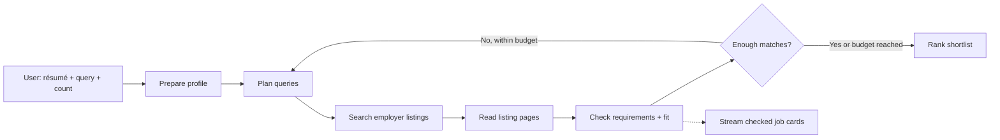

   

# Proof — Job Matcher

Upload a résumé, describe the job you want, and choose how many results to find. Default: **5**.

The agent searches employer listings, reads the requirements, and checks the fit against résumé evidence. Cards appear as each listing finishes. The activity feed shows real tool calls and outputs through server-sent events.

## Run

Python 3.12+. The app, framework, parser, and database are open source. Nimble is a paid hosted API; no separate model key is required.

```sh
git clone https://github.com/ojusave/nimble-proof-agent.git
cd nimble-proof-agent
python3 -m venv .venv
source .venv/bin/activate
pip install -r requirements.lock
cp .env.example .env
```

Set `NIMBLE_API_KEY` in `.env`, then:

```sh
python app.py serve
```

Open http://127.0.0.1:8765. **Try a sample search** uses a fictional résumé and jobs with no API calls. PDF, DOCX, and UTF-8 TXT résumés are supported. Scanned PDFs need OCR first. Provider prompts use bounded résumé and listing excerpts to fit Nimble’s input limit; content beyond those excerpts may be missed.

## Workflow



- Explicit preferences are strict. Conflicts are excluded; unknown requirements appear in a separate review list and do not count toward the requested total.
- Only specific employer or employer-hosted ATS listings qualify. An application instruction provides evidence of availability; it is not a guarantee the employer is still accepting applicants.
- Fit requires matching quotations from both the résumé and retrieved listing. Quotes prove provenance, not semantic correctness. If Nimble omits a résumé quote, a conservative local skill vocabulary pairs exact résumé lines with exact listing quotes, labeled “Shared skill.” Matching and requirement interpretation remain fallible model judgments.
- Two search rounds by default. If there are fewer matches, the agent asks what to relax. It never changes requirements automatically.
- Up to two listing assessments run concurrently. Cards appear when each assessment returns; final order is set at completion.

Nimble Search discovers listings, Extract reads them, and Agent API plans searches and assesses fit. These are separate adapters behind provider-neutral interfaces.

## Replace a component

| Location | Responsibility |
| --- | --- |
| `core/ports.py`, `core/models.py` | Shared interfaces and records |
| `workflows/job_matcher.py` | Job-specific rules; no framework or provider imports |
| `runners/langgraph.py` | LangGraph nodes, edges, and retry-search branch |
| `adapters/nimble/` | Nimble HTTP calls, remote status, public progress events |
| `adapters/resume/` | Local PDF, DOCX, TXT parsing |
| `adapters/storage/` | SQLite résumés, history, ordered events |
| `composition.py` | Wire different Search, Extract, Reasoner, or Runner implementations |
| `api/`, `web/` | HTTP/SSE transport and browser UI |

Use the same interfaces and event format for another assignment. New business rules belong in a new workflow. Run limits live in `core/settings.py`.

## Data and limits

Résumés are saved locally until removed. Obvious email and phone strings are removed before requests; remaining résumé text and job pages are sent to Nimble. Removing a résumé deletes its original file and stored text; previous results retain selected supporting quotations.

`data/`, `.env`, and `.venv/` are excluded from Git. The server binds to localhost, checks origins, and exposes only the three UI files. No LangSmith account, tracing service, or frontend build service is required.

Live searches use Nimble credits. Agent creation is not retried automatically; a lost response can still have created a paid job. Provider tasks can run for minutes. The UI relays public provider progress when available and otherwise shows actual queued/running status. It never fabricates internal reasoning. Closing the browser leaves the server running; restarting the server interrupts local workflows. Automatic workflow resumption and cancellation are not implemented.

## Tests

```sh
python -m unittest discover -s tests -v
```

Tests cover the actual LangGraph flow, strict/unknown requirements, fabricated evidence, source failures, résumé formats, uploads/removal, concurrent events, SSE replay, and exports. The synthetic demo runs the same workflow with fixture adapters. Live provider checks require the local key.

[Design](docs/design.md) · [Demo walkthrough](docs/demo.md) · [Open-source components](NOTICE.md)

Run the same job workflow offline with `python app.py demo`.

[MIT license](LICENSE)
