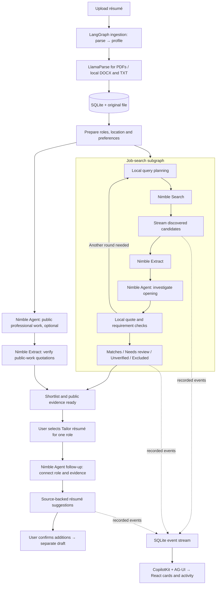

<h1 align="center">Proof</h1>

<p align="center"><b>Research job openings. Connect your work to the role. Review the evidence.</b></p>

<p align="center">
  <a href="https://github.com/ojusave/nimble-proof-agent/actions/workflows/test.yml"></a>
  <a href="https://docs.nimbleway.com/nimble-sdk/web-search-agents/quickstart"></a>
  <a href="https://developers.llamaindex.ai/llamaparse/parse/getting_started/"></a>
  <a href="https://github.com/langchain-ai/langgraph"></a>
  <a href="https://nextjs.org/"></a>
  <a href="https://github.com/CopilotKit/CopilotKit"></a>
  <a href="LICENSE"></a>
</p>

Proof turns a résumé and optional preferences into an inspectable job shortlist. It shows discovered pages immediately, checks individual openings, and separates confirmed matches, missing evidence, and sources that could not be verified.

Optionally, Nimble researches your public professional work alongside the job search. It connects source-backed findings to each role’s requirements and proposes résumé additions for you to confirm. A published project can reveal experience absent from a résumé; it cannot establish experience you never had.

<p align="center"><strong>
  <a href="#quick-start">Quick start</a> ·
  <a href="#features">Features</a> ·
  <a href="#architecture">Architecture</a> ·
  <a href="#apis-and-source">APIs and source</a> ·
  <a href="#verification">Verification</a>
</strong></p>

<p align="center"></p>

## Quick start

Requires **Python 3.12+** and **Node 22.12+**.

```sh
git clone https://github.com/ojusave/nimble-proof-agent.git
cd nimble-proof-agent
python3 -m venv .venv
source .venv/bin/activate
pip install -r requirements.lock
npm ci
cp .env.example .env
npm run dev
```

Open [localhost:8765](http://127.0.0.1:8765/). **Try a sample** uses a fictional résumé and fictional jobs without paid API calls. Keep the terminal running: it starts Next.js on **8765** and FastAPI on **8767**. For a production build, stop development, run `npm run build`, then `npm start`.

For live use, add server-side keys to `.env` and restart:

| Setting | Purpose |
| --- | --- |
| `NIMBLE_API_KEY` | Live Search, Extract, and Agent research. |
| `LLAMA_CLOUD_API_KEY` | Optional LlamaParse PDF parsing. Without it, PDFs use local text extraction; scanned PDFs need OCR. |
| `PROOF_DATA_DIR` | Optional isolated storage directory. |
| `PROOF_BACKEND_URL` | Optional Python API URL, server-only. Default: `http://127.0.0.1:8767`. |
| `NEXT_PUBLIC_TRACE_TRANSPORT=sse` | Optional native SSE replacement for CopilotKit; set before starting/building. |

No separate model key or CopilotKit cloud account is required. Keys never go into browser code. LlamaParse receives the full PDF; Nimble receives selected professional résumé passages and research inputs. Files and search history are saved in the workspace.

Upload a **PDF, DOCX, or UTF-8 TXT** résumé, up to **3 MB**; PDFs are limited to **10 pages**. Leave preferences blank to use inferred professional roles and the résumé’s header location, or enter a role/location to override the defaults. The search displays the location it actually uses. Location does not establish work authorization.

To research beyond the résumé, expand **Include my public work** and supply professional URLs that belong to you. These establish identity; Nimble can follow relevant sources beyond those starting links. It does not research private life or infer sensitive traits.

<details>
<summary>PDF parsing and résumé location</summary>
<p>Actual LlamaParse ingestion of a generated fictional PDF, with recorded LangGraph parse/profile nodes.</p>
<p align="center"></p>
</details>

## Features

- **Results as they arrive.** Discovered URLs appear under Checking before assessments finish. Verified roles move to Matches or Needs review. Retrieval failures stay Unverified, including in older saved runs.
- **Location-aware discovery.** Explicit location preferences win. Otherwise, a conservatively recognized résumé-header location informs queries and local/remote eligibility checks. Former job or school locations are not treated as your home.
- **Individual openings, not directory pages.** Search targets employer and ATS pages first. Captured career-index links can lead to relevant individual roles; indexes themselves never become recommended jobs.
- **Evidence you can inspect.** Paired résumé/listing quotations, requirement checks, source passages, provider citations, and unresolved gaps appear in an evidence drawer. Provider confidence cannot override missing evidence.
- **Parallel Nimble research.** Job research and optional applicant research run in separate LangGraph branches. One applicant dossier is reused across roles in the search. Once both branches finish, choose a role to ask Nimble to connect the evidence.
- **Reviewable résumé additions.** Each proposal connects a job quote to an external source quote. Confirm accurate personal attribution and wording before downloading selected additions in a separate Markdown résumé draft. The original stays intact, and proposals do not automatically upgrade job-fit decisions.
- **Apply and keep control.** Apply opens a captured application link or the original employer page. Stop prevents new local work and retains received results. History, reconnect, and replay observe an existing search without creating paid tasks again.

A missing fact is not a conflict. “Remote” without a hiring region does not confirm eligibility from a particular location. A failed page load says nothing about your suitability. Public project ownership does not, by itself, establish production use, team leadership, or a business metric.

<details>
<summary>Inspect a sample result’s supporting evidence</summary>
<p align="center"></p>
</details>

<details>
<summary>Review proposed résumé additions before downloading a separate draft</summary>
<p>The following is a fictional review fixture, not a live research result.</p>
<p align="center"></p>
</details>

## Architecture



The complete job-search subgraph runs alongside applicant research. A parent-graph synchronization barrier therefore cannot hold up discovery while the applicant branch works. Job cards stream before the join. Tailoring is a separate user-triggered LangGraph operation for one selected role; it reuses Nimble’s native continuation context when available. No tailoring task is created automatically.

The application controls acceptance, persistence, and presentation. Nimble controls the research inside each delegated task. Identity seeds are not a source allowlist. Public facts must pass source-quote checks; résumé additions must connect an accepted fact ID to an exact captured job quote. Human confirmation remains necessary for attribution and interpretation.

See [system design](docs/design.md) for graph boundaries, event contracts, cancellation, storage, and hosted behavior.

## APIs and source

| Purpose | Integration | Source |
| --- | --- | --- |
| Parse PDF layout and OCR | LlamaIndex LlamaParse v2, agentic tier, pinned version; per-page Markdown | [`adapters/llamaindex/parser.py`](adapters/llamaindex/parser.py) |
| Find possible openings | Nimble `POST /v2/search` | [`adapters/nimble/search.py`](adapters/nimble/search.py) |
| Capture a page | Nimble `POST /v2/extract`, JavaScript rendering | [`adapters/nimble/extract.py`](adapters/nimble/extract.py) |
| Investigate openings, public work, and role connections | Nimble Agent: create once, observe, fetch structured output and trust | [`adapters/nimble/agent.py`](adapters/nimble/agent.py) |
| Decide what qualifies | Named prompts, explicit requirements, local quote checks | [`workflows/job_matcher.py`](workflows/job_matcher.py), [`workflows/prompts.py`](workflows/prompts.py) |
| Research public work | One reusable dossier per search; source and identity checks | [`workflows/applicant_research.py`](workflows/applicant_research.py) |
| Tailor a selected role | On-demand Nimble follow-up; evidence joins by role/fact IDs | [`workflows/resume_tailoring.py`](workflows/resume_tailoring.py) |
| Choose résumé location | Offline header extraction and explicit-preference precedence | [`workflows/resume_profile.py`](workflows/resume_profile.py) |
| Follow captured role links | Deterministic link extraction and relevance ordering | [`workflows/discovery.py`](workflows/discovery.py) |
| Orchestrate | LangGraph ingestion, concurrent branches, join | [`runners/resume_ingestion.py`](runners/resume_ingestion.py), [`runners/langgraph.py`](runners/langgraph.py) |
| Persist and serve | SQLite ordered events, FastAPI HTTP and SSE | [`adapters/storage/sqlite.py`](adapters/storage/sqlite.py), [`api/app.py`](api/app.py) |
| Stream to the UI | Read-only AG-UI observer, CopilotKit adapter, optional native SSE | [`api/agent.py`](api/agent.py), [`ui/composition.tsx`](ui/composition.tsx) |
| Render results and proposals | React components with provider-neutral records | [`ui/components/RunDashboard.tsx`](ui/components/RunDashboard.tsx), [`ui/components/ResumeSuggestions.tsx`](ui/components/ResumeSuggestions.tsx) |

Each provider has its own adapter. [`core/ports.py`](core/ports.py) defines replaceable interfaces; [`composition.py`](composition.py) wires them. Workflow rules import neither Nimble’s transport nor LangGraph. LlamaParse uses the documented v2 REST API through HTTPX; the app does not add a vector index or claim to use the entire LlamaIndex framework.

API references: [Search](https://docs.nimbleway.com/api-reference/search/search), [Extract](https://docs.nimbleway.com/api-reference/extract/extract), [Nimble Agent](https://docs.nimbleway.com/nimble-sdk/web-search-agents/quickstart), [research effort](https://docs.nimbleway.com/nimble-sdk/web-search-agents/efforts), [LlamaParse configuration](https://developers.llamaindex.ai/llamaparse/parse/guides/configuring-parse/).

## Activity and practical limits

<details>
<summary>Inspect actual LangGraph execution</summary>
<p>A completed fictional sample, showing recorded node calls and durations. Live searches use the same event view.</p>
<p align="center"></p>
</details>

PDF uploads stream parser status and actual ingestion-node spans. Saved searches label reused parsing with its original timestamps and job ID. Activity shows actual recorded LangGraph node inputs/outputs and durations, returned results, local decisions, timestamps, and provider run IDs. Stages and cards appear from received events, with no invented progress percentage or hidden model reasoning. Both research branches and role-tailoring tasks appear in the trace. An open evidence drawer stays open while other results arrive. Node summaries omit the full résumé and credentials; the recorded evidence remains inspectable.

Nimble structured research uses **high effort**, matching its recommendation for output schemas. It can take minutes per task. Progressive cards improve visibility; they do not make research instant. By default the app performs two discovery rounds, with two concurrent opening assessments and a separate applicant branch when requested. Tailoring starts only when you select a role. This can create multiple billable Agent tasks.

Local orchestration bounds remain explicit in [`Settings`](core/settings.py): candidate fan-out, a 20-minute Agent observation timeout, HTTP timeouts, and a bounded input/passage budget. These do not restrict Nimble’s internal research to the starting URLs. Agent and PDF job creation are never blindly retried after a lost response. **Stop** halts local submissions and observation; already accepted remote tasks may continue.

Quote matching checks provenance, not truth or entailment. Role, employer, suitability, attribution, and suggested wording still require judgment. Broad or unusual role names and ambiguous résumé locations may need explicit preferences. The UI preserves uncertainty instead of assigning a “100% fit” score.

Files, parsed text and pages, parser provenance, research reports, and selected evidence persist in the workspace. Removing a résumé deletes its original and parsed metadata; saved runs retain their supporting quotations. Hosted access is one password-protected shared workspace, not separate user accounts. Restarts interrupt active runs; automatic resumption is not implemented.

## Verification

```sh
python -m unittest discover -s tests -v
npm run typecheck
npm test
node tests/activity.test.mjs
npm run build
python app.py demo
# Against a running isolated local instance:
npm run test:ui
```

Tests cover upload/parsing, location precedence, the parallel graph join, candidate streaming, quote validation, source errors, résumé proposals and draft selection, Stop, replay, access boundaries, and desktop/mobile flows. Dependencies are locked in `requirements.lock` and `package-lock.json`; CI runs the offline suite without paid provider calls.

The live PDF check used a generated fictional résumé and recovered its header location. A live search correctly rejected two stale openings. A separate known-opening check returned a confirmed SerpApi match with locally checked quotations. These are integration observations, not a job-market coverage benchmark. [Verification notes](docs/verification.md) distinguish live checks from controlled fixtures.

To repeat the bounded Nimble integration check with fictional résumé data and configured paid access:

```sh
python scripts/verify_nimble.py --live
```

Reports are written to ignored `work/` storage. `.env`, uploaded files, local databases, generated builds, and verification artifacts are excluded from Git and Docker contexts.

[System design](docs/design.md) · [Demo and talk notes](docs/demo.md) · [Dependency notices](docs/NOTICE.md) · [MIT license](LICENSE)
