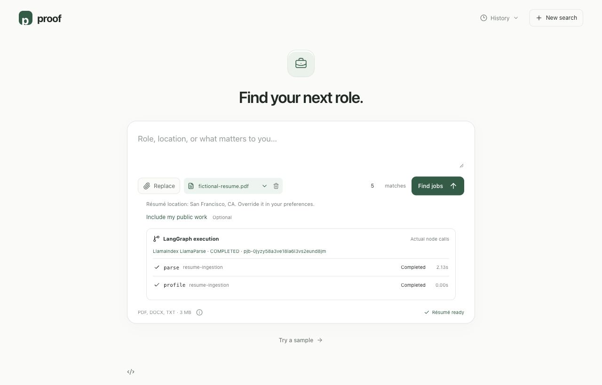
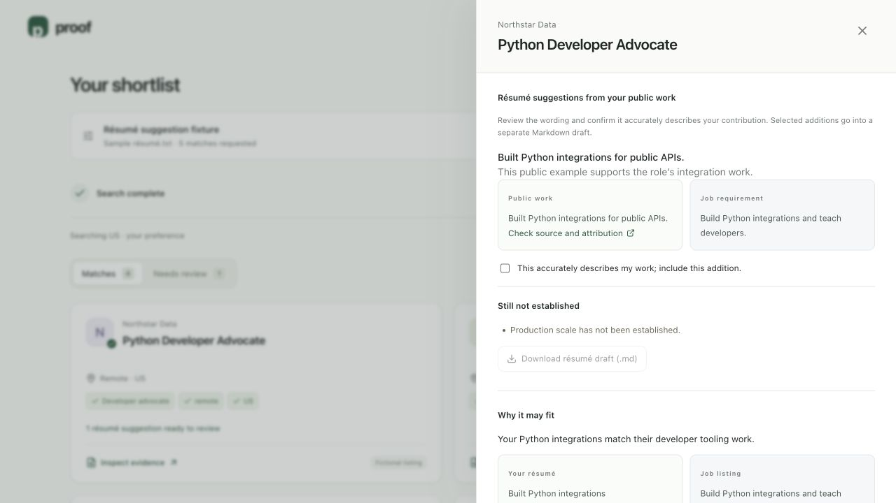
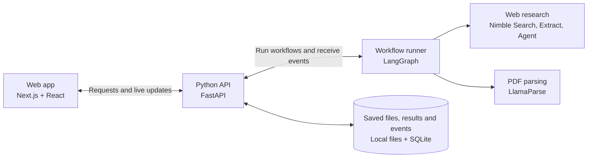
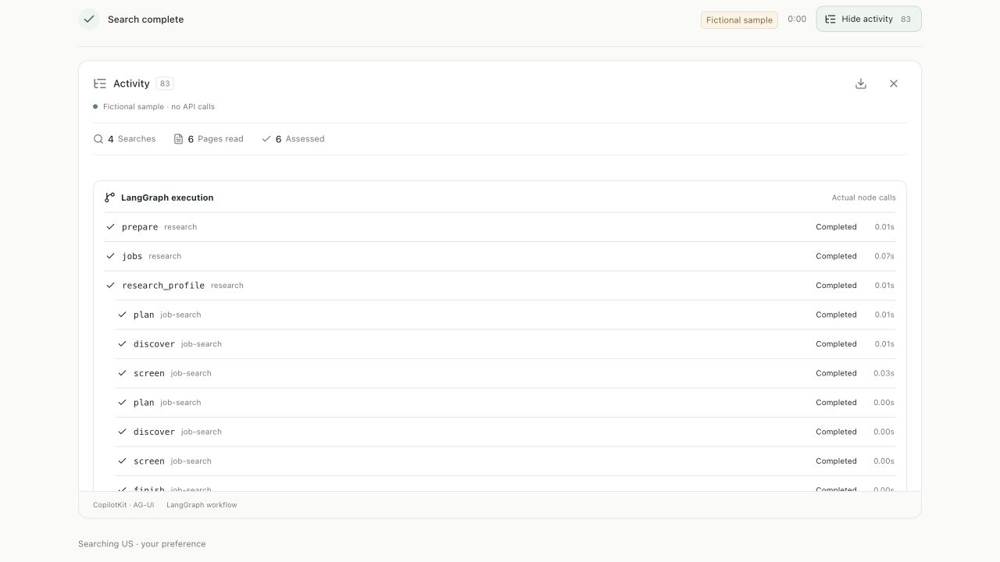

<h1 align="center">Proof</h1>
<p align="center"><b>A job research agent that explains its recommendations.</b></p>

<p align="center">
  <a href="https://github.com/ojusave/nimble-proof-agent/actions/workflows/test.yml"></a>
  <a href="https://docs.nimbleway.com/nimble-sdk/web-search-agents/quickstart"></a>
  <a href="https://developers.llamaindex.ai/llamaparse/parse/getting_started/"></a>
  <a href="https://github.com/langchain-ai/langgraph"></a>
  <a href="https://nextjs.org/"></a>
  <a href="https://github.com/CopilotKit/CopilotKit"></a>
  <a href="LICENSE"></a>
</p>

**Upload a resume, find relevant job openings, and see the evidence behind each recommendation.** Proof searches the web, reads individual job postings, and compares their requirements with your experience. Each result includes supporting quotes, missing information, and a link to the employer's application page.

You can also add your GitHub or portfolio links. Proof researches that public work alongside the job search. When you choose a role, it can suggest resume additions supported by those sources. You review the wording before downloading a separate draft.

[Try it locally](#run-locally) · [How it works](#how-it-works) · [Architecture](#architecture) · [Read the code](#read-the-code)

<p align="center"></p>

## What you do

1. **Upload a resume** as PDF, DOCX, or TXT.
2. **Add preferences if you want.** Enter a role, location, or requirements. Leave this blank to use the professional roles and location recognized in your resume. The app shows the location it uses.
3. **Optionally add your public work.** Supply your GitHub, portfolio, or other professional links under **Include my public work**.
4. **Start the search.** Candidate pages appear while research continues. Open a result to inspect the job requirements, the matching resume passages, and any gaps.
5. **Choose what to do next.** Open the employer's application page, or select a role for resume suggestions. Confirm accurate additions and download a Markdown draft. Applications are submitted on the employer's site.

For example, a resume might describe a Developer Advocate based in San Francisco with Python experience. Proof uses the role and location to plan its search. If a posting says “remote” but does not establish eligibility from that location, it remains **Needs review**. You can inspect the missing evidence yourself.

## Run locally

Install **Python 3.12+** and **Node 22.12+**, then:

```sh
git clone https://github.com/ojusave/nimble-proof-agent.git
cd nimble-proof-agent
python3 -m venv .venv
source .venv/bin/activate
pip install -r requirements.lock
npm ci
cp .env.example .env
npm run dev
```

Open [http://127.0.0.1:8765](http://127.0.0.1:8765/). Keep the terminal running. This command starts both the web app on port **8765** and the Python API on port **8767**.

Click **Try a sample** to explore the complete interface with a fictional resume and fictional jobs. It needs no API keys and makes no paid calls.

For a real search, add your keys to `.env` and restart the app:

```dotenv
NIMBLE_API_KEY=your_nimble_key
LLAMA_CLOUD_API_KEY=your_llamacloud_key
```

- **Nimble is required for live research.** Its Search, Extract, and Agent APIs find and investigate openings and public work.
- **LlamaParse is optional.** With its key configured, PDFs go through LlamaIndex's document parsing service, including OCR. Otherwise, PDFs use local text extraction. DOCX and TXT are always read locally.

No separate model API key or CopilotKit cloud account is required. Uploads support files up to **3 MB** and PDFs up to **10 pages**. To run a production build locally, stop development, run `npm run build`, then `npm start`.

<details>
<summary>See a PDF upload and detected location</summary>
<p>This capture shows a real LlamaParse call on a generated fictional PDF.</p>
<p align="center"></p>
</details>

## How it works

**Read the resume.** The upload workflow extracts text, records which parser was used, and looks for a location in the document's header. Preferences override that location. Reusing a saved resume reuses its parsed text.

**Find openings.** A local planner turns the role and location into queries. Nimble Search returns possible job pages. The app favors employer sites and recruiting platforms such as Ashby and Greenhouse. When it finds a directory, it can follow relevant links to individual openings.

**Investigate each job.** Nimble Extract reads the listing. Nimble Agent researches the opening and returns structured findings. Proof checks whether the quoted evidence appears in the captured sources and whether the requested conditions are supported. A search result alone is not a recommendation.

**Research your public work, if requested.** A second Nimble research task runs alongside the job search. Your links establish a starting identity; the agent can follow other relevant professional sources. Proof captures the cited pages and checks the returned quotations.

**Connect the evidence to one role.** After the research finishes, select **Tailor resume for this role**. Nimble uses the selected job and the public-work findings to propose relevant additions. Every accepted suggestion links a job requirement to a source quote. You confirm each addition before downloading a separate `.md` file; the original document stays intact.

The result categories explain what the app established:

| Category | What it means |
| --- | --- |
| **Checking** | A page was found; the investigation is still running. |
| **Matches** | Supporting quotes and the app's checks passed. Review the evidence before applying. |
| **Needs review** | A possible opening has missing or unconfirmed evidence. |
| **Unverified** | A source could not be read or researched successfully. |
| **Not included** | The page was a directory, a closed opening, or failed another explicit check. |

<details>
<summary>See the evidence behind a recommendation</summary>
<p>Fictional sample data, with resume and job quotes shown together.</p>
<p align="center"></p>
</details>

<details>
<summary>See how you review a proposed resume addition</summary>
<p>This is a controlled fictional example of the review interface.</p>
<p align="center"></p>
</details>

## Architecture

The browser displays results. The Python API starts work and saves it. LangGraph coordinates the steps, while provider adapters make the external API calls.



| Component | Its job in Proof |
| --- | --- |
| **Next.js + React** | Upload form, job cards, evidence drawers, and review controls. |
| **FastAPI** | Receives requests to upload, search, stop, tailor, and export. |
| **LangGraph** | Runs resume ingestion, parallel job/public-work research, and the separate selected-role tailoring workflow. |
| **Nimble** | Finds pages, reads sources, and performs the web research. |
| **LlamaParse** | Converts PDFs into text and page content. Local parsers handle the other file types. |
| **SQLite + local files** | Preserve uploads, results, and an ordered history of execution events. |
| **CopilotKit + AG-UI** | Deliver the running workflow's recorded events to the UI. They observe existing work; opening Activity does not launch another agent. |

Job research can publish results while public-work research is still running. Tailoring starts only when you choose a role. [System design](docs/design.md) explains those workflows, storage, and replacement boundaries in more detail.

## What the activity view shows

Open **Activity** to inspect actual LangGraph node calls, durations, input/output summaries, Nimble requests, parser status, and the app's decisions. Entries appear when events arrive. Saved parsing is labelled as reused, with its original job ID and timestamps.

The view shows recorded execution and provider progress. It does not invent intermediate steps or expose hidden model reasoning. Reopening a saved search replays its events without creating another paid task.

<details>
<summary>See a recorded execution trace</summary>
<p>A completed fictional sample using the same trace view as live research.</p>
<p align="center"></p>
</details>

## Read the code

Start with the four external API adapters:

| API | Purpose | File |
| --- | --- | --- |
| Nimble Search | Find possible job pages | [`adapters/nimble/search.py`](adapters/nimble/search.py) |
| Nimble Extract | Read job and public-work sources | [`adapters/nimble/extract.py`](adapters/nimble/extract.py) |
| Nimble Agent | Investigate jobs, research public work, and connect evidence to a selected role | [`adapters/nimble/agent.py`](adapters/nimble/agent.py) |
| LlamaIndex LlamaParse | Parse PDFs through the v2 REST API | [`adapters/llamaindex/parser.py`](adapters/llamaindex/parser.py) |

The rest of the code is grouped by responsibility:

| Folder or file | What you will find |
| --- | --- |
| [`workflows/`](workflows/) | Query planning, job checks, applicant research, and resume suggestions. |
| [`runners/`](runners/) | LangGraph graphs and execution order. |
| [`core/ports.py`](core/ports.py) | Interfaces that providers and runners implement. |
| [`composition.py`](composition.py) | Where implementations are selected and connected. |
| [`api/`](api/) and [`adapters/storage/`](adapters/storage/) | HTTP operations and persistence. |
| [`ui/`](ui/), [`app/`](app/), and [`server/`](server/) | React components, Next.js routes, and server-side access to the Python API. |
| [`tests/`](tests/) | Python, UI, and browser checks with their test configuration. |

To replace a provider, implement its interface and change the wiring in `composition.py`. The workflow rules do not import Nimble's HTTP client or LangGraph. Event delivery can also be switched from CopilotKit to native server-sent events through [`ui/composition.tsx`](ui/composition.tsx).

## Before using real data

- **Research takes time and uses paid API calls.** Nimble's structured research can take minutes. Candidates appear early so you can see progress. Stop prevents further local work; remote tasks already accepted by a provider may continue.
- **Quotes support inspection, not certainty.** A page can be outdated, a location can be ambiguous, and public work can be attributed incorrectly. Review the sources and suggested wording. Proof does not claim a perfect-fit score.
- **Know where your data goes.** Configured LlamaParse receives the full PDF. Nimble receives selected professional resume passages and research inputs. Credentials stay server-side. Uploads and history persist in the local workspace; access configuration and data handling are described in [system design](docs/design.md#cancellation-and-persistence).

## Verification

```sh
python -m unittest discover -s tests -v
npm run typecheck
npm test
node tests/activity.test.mjs
npm run build
python app.py demo
```

The sample needs no paid access. Browser checks run through `npm run test:ui` against an isolated local instance; CI starts its own instance automatically.

Live integration checks exercised LlamaParse and Nimble Search, Extract, and Agent with fictional resume data and public sources. They included a checked job match and a selected-role follow-up. The [verification notes](docs/verification.md) separate live observations from controlled fixtures and record the test results.

[System design](docs/design.md) · [Demo and talk notes](docs/demo.md) · [Dependency notices](docs/NOTICE.md) · [MIT license](LICENSE)
