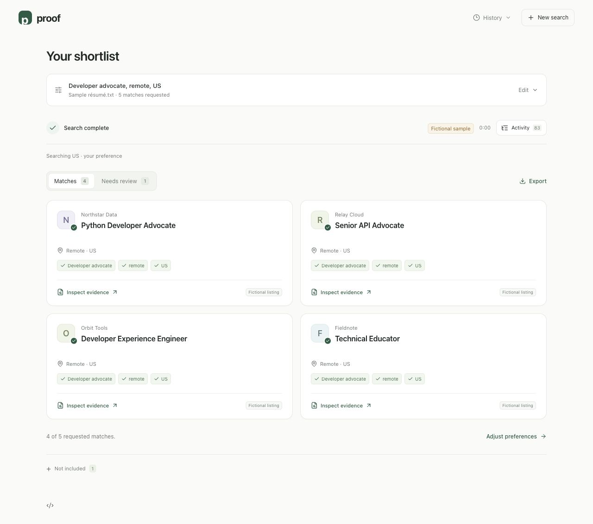
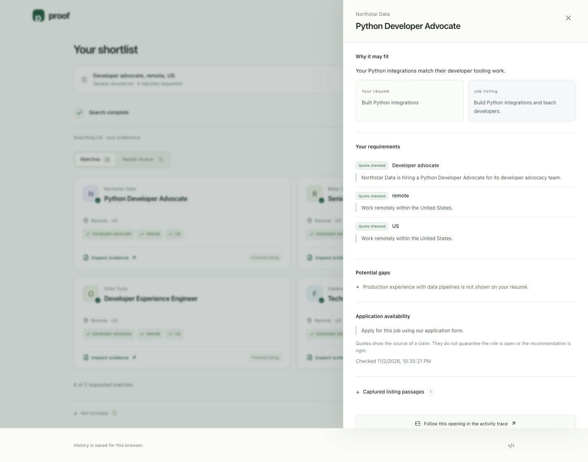
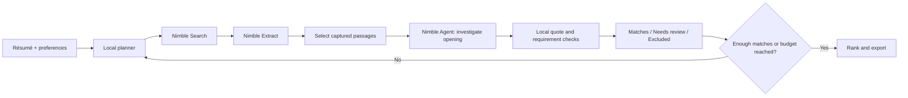

<h1 align="center">Proof</h1>

<p align="center">
  Turn a résumé and job preferences into a shortlist you can inspect.<br />
  Compare the supporting quotes, review missing information, and follow the original openings.
</p>

<p align="center">
  <a href="https://github.com/ojusave/nimble-proof-agent/actions/workflows/test.yml"></a>
  
  
  
  
  
  
  <a href="LICENSE"></a>
</p>

<p align="center">
  <a href="#run-locally">Run locally</a> ·
  <a href="#how-it-works">How it works</a> ·
  <a href="#api-boundaries">API boundaries</a> ·
  <a href="#source-walkthrough">Source walkthrough</a> ·
  <a href="#verification">Verification</a>
</p>

<p align="center">
  
</p>

## Run locally

Use **Python 3.12+ and Node 22.12+**. React and Next.js render the interface, CopilotKit carries the agent events, and LangGraph runs the workflow. Live searches use the paid Nimble API; no separate model key or CopilotKit cloud account is required.

```sh
git clone https://github.com/ojusave/nimble-proof-agent.git
cd nimble-proof-agent
python3 -m venv .venv
source .venv/bin/activate
pip install -r requirements.lock
cp .env.example .env
npm ci
npm run dev
```

Open [localhost:8765](http://127.0.0.1:8765/). **Try a sample** runs the complete workflow with a fictional résumé and fictional jobs, without provider API calls. Keep the terminal running: the command starts the Next.js UI on **8765** and the Python API on **8767** and stops both together. For an optimized local build, stop development, run `npm run build`, then `npm start`.

To run the services separately, use `python app.py serve --port 8767` and `npx next dev --hostname 127.0.0.1 --port 8765`. If the backend port changes, set the server-only `PROOF_BACKEND_URL`. Use `PROOF_DATA_DIR` to select an isolated data directory for demos or testing.

For live searches, set `NIMBLE_API_KEY` in `.env` and restart the server. Keys stay on the server. Upload a text-based PDF, DOCX, or UTF-8 TXT résumé; scanned PDFs need OCR first. Select a result count, enter preferences such as **“Python developer advocate, remote, US”**, and click **Search jobs**.

## How it works

1. **Prepare and plan locally.** Parse the résumé, remove obvious email and phone strings, preserve explicit preferences, and construct discovery queries. No hosted research run is spent generating query strings.
2. **Discover openings.** Search for employer listings, normalize URLs, reject known aggregators, and deduplicate candidates.
3. **Capture evidence.** Extract each page, select relevant passages across a bounded scan, and retain the selected text and source offsets.
4. **Investigate one opening.** Ask the research agent to open the exact listing, check availability, resolve ambiguities using official employer sources, and return a structured assessment plus its trust report.
5. **Apply local decision rules.** Check quotations against captured passages. A conflict excludes a job; missing evidence sends it to **Needs review**, outside the requested match count.
6. **Review and export.** Inspect paired résumé/listing quotes, requirement checks, provider citations, and unresolved gaps. Export includes both matches and openings needing review. If too few qualify, decide which preference to change yourself.

For example, **“Remote”** without an allowed hiring region does not confirm **“US”**. The opening stays in Needs review. A provider's confidence grade cannot override a missing quotation.

## Following the activity

Activity sits across the workspace beneath the run status, grouped by search round and opening. Stages and counters appear only after their recorded events arrive; result tabs appear with the first result or a terminal state. Expand an opening to see retrieval and research outcomes, recorded timestamps, selected evidence, the app's decision, and the original event data. **Follow this opening** connects a result directly to its trace. Download the trace as JSON or export the shortlist as Markdown.

Successful retrieval means a page was read; successful research means output was received. Neither means the opening qualifies. Matches, unknowns, exclusions, and provider errors remain separate. Sample data is labelled throughout; saved runs retain their original timestamps. The UI does not invent percentages or model reasoning.

A new search starts with a blank composer and no selected résumé, trace, or result cards. History and explicit run URLs open saved searches. Refresh and reconnection read the same saved search. They do not create paid tasks again. Open evidence stays open while other results arrive. The full résumé and credentials are omitted from trace events; selected supporting quotations remain inspectable.

**Stop** prevents queued work, retries, polling, and new provider calls. The UI shows **Stopping…** until in-flight HTTP requests return, then preserves results already received. Stopping locally does not confirm cancellation of Nimble tasks already accepted remotely. Closing the browser only disconnects the observer.

<details>
<summary>Inspect a sample result's supporting evidence</summary>
<p align="center"></p>
</details>



## API boundaries

Each API has its own adapter. The application chooses its research scope and acceptance rules.

| Question | API and source | What the app receives |
| :--- | :--- | :--- |
| Where might a relevant opening be? | [`search.py`](adapters/nimble/search.py) — `POST /v2/search` | Candidate URLs and titles; discovery is not validation |
| What does this known page say? | [`extract.py`](adapters/nimble/extract.py) — `POST /v2/extract` | Retrieved Markdown; selected passages are retained with offsets |
| What can we establish about this opening? | [`agent.py`](adapters/nimble/agent.py) — create, observe, fetch result | Structured assessment, run IDs, and `output.trust` |

[`client.py`](adapters/nimble/client.py) owns shared authentication, HTTP errors, and transport limits. [`composition.py`](composition.py) wires the three adapters to the workflow. The Agent adapter owns run creation, polling, optional public progress, and result retrieval. Creation is never retried automatically: a lost response may already have created a paid task.

The research task is in [`workflows/prompts.py`](workflows/prompts.py), and its output contract is in [`workflows/schemas.py`](workflows/schemas.py). Research findings from other employer pages remain context for review; they cannot silently satisfy a requirement without supporting text in the opening itself.

API references: [Search](https://docs.nimbleway.com/api-reference/search/search), [Extract](https://docs.nimbleway.com/api-reference/extract/extract), [Agent lifecycle](https://docs.nimbleway.com/nimble-sdk/web-search-agents/quickstart), [trust report](https://docs.nimbleway.com/nimble-sdk/web-search-agents/trust).

## Source walkthrough

For a short code demo, open the API files above, then the named prompt, then `JobWorkflow.validate`. That shows the requests, instructions, returned evidence, and final acceptance decision in separate places.

| Responsibility | Source |
| :--- | :--- |
| Provider-neutral interfaces and result records | [`core/ports.py`](core/ports.py), [`core/models.py`](core/models.py) |
| Local query planning | [`workflows/planning.py`](workflows/planning.py) |
| Passage selection and input budget | [`workflows/evidence.py`](workflows/evidence.py), [`workflows/prompts.py`](workflows/prompts.py) |
| Job rules and quote validation | [`workflows/job_matcher.py`](workflows/job_matcher.py) |
| LangGraph nodes, edges, bounded second round | [`runners/langgraph.py`](runners/langgraph.py) |
| PDF, DOCX, and TXT parsing | [`adapters/resume/parser.py`](adapters/resume/parser.py) |
| SQLite history and ordered events | [`adapters/storage/sqlite.py`](adapters/storage/sqlite.py) |
| HTTP operations and native event stream | [`api/app.py`](api/app.py) |
| Read-only AG-UI bridge | [`api/agent.py`](api/agent.py), [`adapters/transport/ag_ui.py`](adapters/transport/ag_ui.py) |
| CopilotKit server and client adapters | [`server/copilot.ts`](server/copilot.ts), [`ui/adapters/CopilotConnection.tsx`](ui/adapters/CopilotConnection.tsx) |
| UI contracts and composition | [`ui/core/ports.ts`](ui/core/ports.ts), [`ui/composition.tsx`](ui/composition.tsx) |
| Trace and evidence views | [`ui/components/TracePanel.tsx`](ui/components/TracePanel.tsx), [`ui/components/JobCard.tsx`](ui/components/JobCard.tsx) |
| Exported evidence and uncertainty | [`core/exporting.py`](core/exporting.py) |
| Wiring and limits | [`composition.py`](composition.py), [`core/settings.py`](core/settings.py) |

Business rules import neither Nimble nor LangGraph. Another provider can implement the same ports and return `ResearchResult(content, trust, run_id, agent_id)`. Another graph runner can use the same workflow methods and events. Only the composition changes.

CopilotKit is also an adapter. Result cards and trace rendering consume `SearchSession` and provider-neutral events; they do not import its SDK. Set `NEXT_PUBLIC_TRACE_TRANSPORT=sse` before starting development (or building production) to use the included native SSE adapter. The Python API and CLI work independently of Next.js. See [replaceability and event contracts](docs/design.md) for the exact boundaries.

## Limits and data handling

- **Evidence is inspectable, not infallible.** Exact text checks establish where a quote came from; they do not establish that the interpretation is correct. Title, employer, fit, summaries, and gaps remain model judgments. Domain checks are a heuristic, and application instructions do not guarantee an opening is still available.
- **Selection is bounded.** The selector scans up to 120,000 characters and normally selects up to 4,800 listing characters and 3,000 résumé characters, shrinking as needed to fit the serialized prompt. It scores query terms and job-related cues, and penalizes link-heavy text. Useful information can still be missed. The UI shows selected passages and scan limits.
- **Preferences stay explicit.** Commas, semicolons, and newlines split requirements. Missing/unsupported checks remain unknown. No preferences are relaxed automatically. With no preferences, a small professional vocabulary supplies search terms; specialized roles may need an explicit query.
- **Research is bounded.** Two rounds by default; up to two concurrent listing assessments. The per-round candidate cap is `min(candidates_per_round, max(requested + 2, 4))`, normally seven for five requested matches. Search and Extract HTTP failures may be retried once; Agent creation is not. One run can create multiple paid tasks.
- **Timeouts are local.** The app waits up to five minutes for an Agent run, with separate HTTP request timeouts. A remote task can continue after local waiting ends. Public progress is shown when available; internal reasoning is never requested or fabricated.
- **Local storage persists.** Uploaded files, extracted text, history, selected evidence, and provider trust reports are saved locally. Obvious contact strings are removed before live requests; remaining professional résumé passages and preferences are sent to Nimble. Removing a résumé deletes its original and stored text; previous results retain supporting quotations and research reports.
- **One shared workspace.** Local commands bind to loopback. Hosted mode requires a password and the configured external origin, with access checked at the page and API boundaries. The CopilotKit observer is in memory; SQLite persists history. Local stopping is implemented. Remote task cancellation, restart resumption, and separate user accounts are not implemented.

`.env`, `data/`, `.venv/`, and `work/` are ignored by Git. No tracing account or frontend build service is required. Runtime telemetry is disabled by default in the Next.js configuration. Dependency limitations are recorded in the [verification notes](docs/verification.md).

## Verification

```sh
python -m unittest discover -s tests -v
npm run typecheck
npm test
node tests/activity.test.mjs
npm run build
python app.py demo
# With npm run dev or npm start running in another terminal:
npm run test:ui
```

Browser checks use installed Google Chrome locally. CI installs Playwright Chromium, builds the UI, and starts both services against isolated sample data. Dependencies are locked in `package-lock.json` and `requirements.lock`.

The tests cover the complete offline LangGraph workflow, API request contracts and Agent lifecycle, retained trust, late-page evidence, input budgets, fabricated quotations, strict/unknown requirements, résumé formats, uploads/removal, concurrent events, native SSE and AG-UI replay, startup, exports, browser navigation, evidence, and connection recovery without duplicate searches.

To repeat a bounded live integration check with a **fictional résumé**, configured key, and paid API access:

```sh
python scripts/verify_nimble.py --live
```

This makes two discovery searches and inspects at most two candidates in one round. Reports are written under ignored `work/nimble-verification-*` directories; the user's stored résumés and history are untouched. A successful integration check does not guarantee that any listing is currently open or suitable. See [verification notes](docs/verification.md) for the measured result and its limits.

[System design](docs/design.md) · [Demo and talk notes](docs/demo.md) · [Open-source components](NOTICE.md) · [MIT license](LICENSE)
