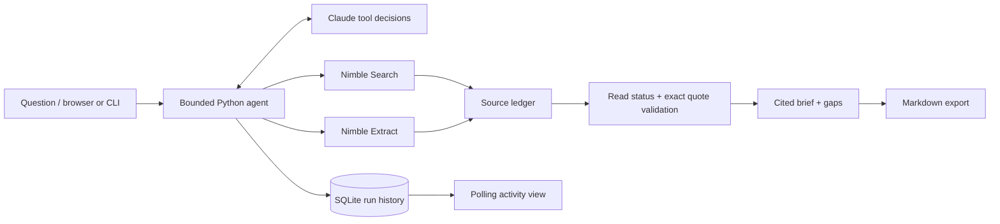

    

# Proof

**Research with receipts.**

A confident answer is easy to generate. A useful answer lets you inspect the evidence.

Proof investigates technical questions using live web data. Claude chooses searches and follow-up reads. Nimble Search discovers sources; Nimble Extract reads their contents. Before a finding can enter the brief, the application checks that its quotation appears in a source the agent actually read.

Use it to compare developer platforms, investigate a feature claim, or prepare a technical briefing. The result includes findings, source links, exact quotes, unresolved questions, and a visible activity trail.

## Start in 30 seconds

Requires Python 3.9 or newer. There are **no third-party Python dependencies**, no Node build step, and no hosted database.

```sh
git clone https://github.com/ojusave/nimble-proof-agent.git
cd nimble-proof-agent
python3 app.py serve
```

Open **http://127.0.0.1:8765**, then click **Try the synthetic demo**.

The offline demo uses fictional companies, synthetic source text, and a scripted model. It exercises the same agent loop, evidence checks, database, UI, and export as a live run. It makes no network requests and is **not evidence of a successful live integration**.

Or run it in your terminal:

```sh
python3 app.py run --demo
python3 app.py run --demo --output data/demo-brief.md
```

See [a sample brief](examples/synthetic-brief.md).

## Run live research

Copy the configuration template:

```sh
cp .env.example .env
```

Edit `.env` locally and add your Nimble and Anthropic API keys. Never commit that file. `ANTHROPIC_MODEL` defaults to `claude-sonnet-4-6`; change it to a tool-capable model your account can access. Existing environment variables take precedence over `.env`.

Restart the server, or run:

```sh
python3 app.py run 'Compare Snowflake and Databricks support for private networking. Use first-party documentation and identify plan restrictions.' --output data/networking-brief.md
```

Queries and extracted public page text are sent to Nimble and Anthropic as needed. Live requests consume your providers' API credits. A run permits up to 10 model turns and 12 tool calls; each provider HTTP request can retry twice after a rate-limit or transient server failure. A call budget is **not** a dollar budget.

**Validation status:** the offline demo, provider request/response adapters with mocked HTTP, evidence checks, and local HTTP endpoints are tested. A live Nimble + Anthropic run still needs to be performed with real keys before relying on this for a live presentation. API access, model availability, quotas, and real-world extraction behavior have not been verified with credentials in this repository.

## Why this is an agent

The live model decides what to search, which discovered sources to read, whether evidence is missing, and when to submit its answer. Tool results return to the model, so it can recover from failed extraction or rejected evidence. This is a bounded decision loop, rather than a fixed search-and-summarize pipeline.

Three tools are available:

| Tool | Work performed |
| --- | --- |
| `search_web` | Nimble Search returns structured sources; the app deduplicates them and assigns stable IDs. |
| `read_source` | Nimble Extract reads a previously discovered source and stores the text in the ledger. |
| `finish_brief` | Validates source IDs, read status, and exact quotation matches before accepting findings. |

The first live turn must search. Only discovered HTTPS sources can be read. A model cannot submit an arbitrary URL as a citation. Rejected quotes return as tool errors so the model can correct them. At the budget limit, the run fails explicitly instead of presenting an incomplete result as finished.

## Architecture



Nimble supplies the live evidence at two distinct stages: discovery and full-page reading. Without it, the live agent has no source tools. Other search providers may support a similar architecture; this project does not claim an exclusive capability or unmeasured performance advantage. Benchmark extraction coverage, latency, freshness, and cost on your own questions.

Beyond Nimble, the project uses Python for orchestration, Claude for tool selection, SQLite for persistence, and JavaScript/HTML/CSS for the UI.

## Evidence checks and their limits

A quotation is accepted only if its normalized text appears in the stored extracted content. Findings citing unread or unknown sources are rejected. A brief supported by only one source must disclose that limitation.

This proves text provenance inside the run, **not factual truth or logical entailment**. A real quotation can still be outdated, biased, or misinterpreted. The summary is model-generated and is not independently fact-checked. Search rankings and retrieval timestamps do not establish publication date. Review the sources before using an answer to make a decision.

Page text is treated as untrusted data in the model instructions. Quotes and findings are rendered as plain text, never injected as HTML. These measures reduce risk but do not prove resistance to prompt injection. No browser actions, shell execution, or arbitrary local file access are exposed to the model.

## Development

```sh
python3 -m unittest discover -s tests -v
python3 app.py run --demo --json
```

Tests cover the full scripted agent cycle, recovery after fabricated evidence, source deduplication, read gating, call budgets, provider contracts, failed extraction, blocked local URLs, persistence, exports, request validation, and foreign-origin rejection. GitHub Actions runs them on Python 3.9, 3.12, and 3.13.

| File | Responsibility |
| --- | --- |
| `proof/agent.py` | Tool loop, source ledger, evidence validator, Markdown export |
| `proof/providers.py` | Nimble and Anthropic HTTP adapters, response limits, retries |
| `proof/server.py` | Loopback HTTP app and asynchronous run worker |
| `proof/storage.py` | SQLite run and trace persistence |
| `proof/demo.py` | Clearly labelled synthetic offline fixture |
| `web/` | Browser UI with activity trail, sources, and export |
| `tests/` | Unit and local HTTP integration tests |

## Local use

The server binds to `127.0.0.1`. It allows one active run and checks Host and Origin headers. Only three static UI files are served; `.env`, source files, and database files are not downloadable through the server. Keys remain server-side and are not written into run records. Run history and extracted source text live in `data/proof.db`, which Git ignores.

This is a local research app. Do not expose it to a public network without adding authentication, deployment hardening, retention controls, and operational monitoring. The URL filter rejects obvious local targets, but remote DNS and redirect behavior are handled by Nimble; this is not a complete remote URL security policy. If the process stops during research, its persisted run can remain marked running; start another run after restarting.

## API references

The adapters follow [Nimble Search v2](https://docs.nimbleway.com/api-reference/search/search), [Nimble Extract v2](https://docs.nimbleway.com/api-reference/extract/extract), and the [Claude Messages API](https://platform.claude.com/docs/en/api/messages/create). API contracts were checked on October 26, 2026. The client uses the compatible `2023-06-01` Anthropic API version header.

See [the demo walkthrough](docs/demo.md) for a presentation sequence and [the design notes](docs/design.md) for tradeoffs.

## License

[MIT](LICENSE).
