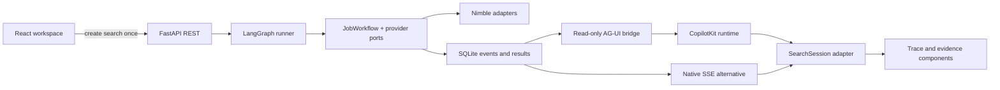

# System design

The user uploads or reuses a résumé, enters optional preferences, chooses a count (default five), and clicks Find jobs. No separate setup wizard.

React and Next.js render the workspace. TanStack Query handles saved data and request state. FastAPI creates a search and returns its ID immediately; a background worker executes the real LangGraph workflow. Ordered domain events are persisted in SQLite. CopilotKit's headless `useAgent` subscribes through a local runtime to an AG-UI observer of that existing search. One search is active per Python server.

## Workflow state

Profile, original preferences, explicit requirements, requested count, search round, seen URLs, candidates, accepted matches, unknowns, exclusions, warnings, and final shortlist.

The graph is prepare → plan → discover → screen → finish. After screening, a conditional edge returns to planning if fewer matches qualify and the round budget remains. Original requirements are retained verbatim during replanning.

## Replaceability

Business rules depend on SearchProvider, ExtractProvider, and Reasoner protocols. LangGraph is isolated in its runner. Composition wires the adapters; settings own keys and limits. The UI consumes domain events and job records, not provider SDK objects.

The live adapters are `NimbleSearch`, `NimbleExtract`, and `NimbleAgent`, each in its own file and sharing one `NimbleClient` transport. `ResearchResult` carries structured content separately from the provider's trust report and run IDs. Query planning is deterministic local code. Hosted Agent runs investigate individual openings, using a named prompt and task-specific schema.

| Replace | Boundary | Files to change |
| --- | --- | --- |
| A search, extraction, or research provider | Python protocols in `core/ports.py` | Add an adapter; select it in `composition.py`. |
| LangGraph | Runner port with `run(workflow, state)` | Replace `runners/langgraph.py` through composition; reuse workflow methods. |
| CopilotKit | `SearchSession` with run, events, connection, error, reconnect | Select `SseConnection` in `ui/composition.tsx`, or implement another adapter. |
| HTTP data access | `SearchRepository` | Replace `ui/adapters/httpRepository.ts`; components keep the same records. |
| Next.js hosting | React views + local API contracts | Replace `app/`, `server/`, and Workspace's URL navigation; keep trace/result components and the Python service. |

`NEXT_PUBLIC_TRACE_TRANSPORT=sse` selects the included native adapter at startup/build time. Both adapters use the same result records, event reducer, and components. Removing CopilotKit's packages entirely also requires removing its imports and runtime route; it is a confined integration, not a dependency-free toggle. The UI has no Nimble key and performs no provider calls. Backend deployment configuration lives in `server/backend.ts`; Python settings are in `core/settings.py`.

Next.js is used rather than a browser-only build because the CopilotKit runtime needs a server route. No extra LLM service runs in that route. The LangGraph workflow is deterministic orchestration around the existing Nimble research tasks, not a second agent making competing decisions.

## Evidence and decision rules

A candidate must be an individual opening on an employer domain or recognized employer ATS. The model identifies the employer website; domain checks reject aggregators and mismatched hosts. This is evidence-based classification, not independent certification of domain ownership.

Application availability needs an exact quote. Every explicit requirement is met, conflicting, or unknown. Missing checks and unverified quotes become unknown. Conflicts are excluded. At least one professional strength must have an exact résumé quote and exact listing quote. Protected or sensitive traits must not be used for matching.

Matching is still model-based and can misinterpret text. Word matching does not prove entailment, current availability, or suitability. The UI exposes evidence and gaps for review. Unknown jobs are separate from qualifying matches.

Extraction retains the retrieved Markdown rather than a fixed leading excerpt. The selector scans at most 120,000 characters and ranks verbatim passages by query terms and job-related cues. The input builder fits selected résumé/listing passages into the Agent input budget without trimming explicit requirements. Source offsets and selected text are saved; adjacent passages are merged, while omitted gaps cannot become invented quotations. This selection is heuristic and can miss evidence.

Provider trust is saved in full and shown separately from locally checked quotations. Research on other employer pages may clarify a gap, but it cannot upgrade a requirement without a supporting quote from the captured opening. Trust and passage selection are also retained in activity for excluded candidates. Exports preserve supporting quotes, unknown requirements, and provider research reports for included/review jobs.

## Real-time events

Events include type, stage, timestamp, tool, safe inputs, and actual output summaries. Events are emitted before and after calls; accepted/unknown/excluded records are emitted per candidate. Listing assessments run concurrently with at most two workers. IDs are assigned locally; requirement checks use fixed schema keys, so model-generated IDs cannot mix up listings. Providers may stream public progress; hidden reasoning is not requested or displayed.

The stream reads a run-state snapshot before fetching its remaining events, preventing a final event from being skipped when completion races with delivery. Last-Event-ID allows reconnect without replaying old events.

The AG-UI adapter emits `RUN_STARTED`, state snapshots, tool argument/result events, and terminal `RUN_FINISHED` or `RUN_ERROR`. Each persisted event also travels as `CUSTOM` named `proof.activity`, preserving its original ID, sequence, timestamp, and candidate identity. AG-UI `TOOL_CALL_END` closes the argument stream; only a returned result counts as provider output. Failed or unresolved calls are explicitly marked as having no output.

The browser deduplicates by persisted sequence. The AG-UI observer may replay from the beginning on reconnect; this neither duplicates visible activity nor recreates searches. The native adapter uses EventSource's Last-Event-ID. An observer's connection status is separate from the persisted search status. Disconnecting or aborting an observer does not cancel a paid task.

## Trace presentation

1. The summary shows the current step, elapsed time, confirmed matches, review count, and connection problems. It has no guessed progress percentage.
2. Activity spans the workspace beneath the run status. It appears only after events arrive, with no planned stages or zero-valued counters preloaded. It groups planning/search rounds and individual openings. Expansion reveals recorded retrieval and research outcomes and then the application's acceptance decision. Provider failures remain distinguishable from a valid exclusion.
3. Evidence cards show paired quotations, unknown requirements, retained passages, and provider citations. Each card links to its opening in Activity. Raw event data and downloadable JSON preserve request identities and provenance without putting a full log on the main screen.

React keys preserve an open evidence card when other candidates finish. Timestamps come from recorded events; only elapsed time for an active run uses the current clock. Saved runs and fictional samples are labelled. There is no synthesized chain of thought. Provider claim explanations are shown as provider-reported context, separately from application validation.

## Persistence and lifecycle

Files and extracted résumé text are local. Removal deletes both; derived evidence and research reports in search history remain. Files and the database use owner-only permissions. The app does not log its full résumé input or credentials; output quotations and provider trust reports can contain selected résumé evidence.

The server runs independently of the browser. CopilotKit uses an in-memory observer runner; SQLite owns durable history. New search clears the composer and selection; saved runs open only through History or an explicit run URL.

## Stopping a search

`POST /api/searches/{id}/stop` moves a running search to `stopping` and signals the run's `CancellationToken`. The workflow checks before queued calls and the shared transport checks before requests and after responses. Retry and polling waits are interruptible. Already-sent synchronous HTTP requests must return; the UI stays in `stopping` while this happens.

The worker then records `run_stopped`, persists a partial result assembled from received events, and marks the run `stopped`. A shared lock serializes completion and stop requests; repeated stops preserve terminal state. Both SSE and AG-UI emit state changes without turning an observer disconnect into cancellation. The UI keeps confirmed and review results separate. Remote Nimble tasks may continue, and the UI says so.

## Hosted workspace

`server/access.ts` is a replaceable access adapter for one shared workspace. Both `proxy.ts` and the API routes enforce HTTP Basic authentication in hosted mode. Render terminates HTTPS. The configured external origin is authoritative; forwarded host headers cannot enable the loopback bypass. Missing or weak hosted credentials fail closed. API bodies are bounded before being passed downstream. This is not per-user tenancy: anyone with the password shares all data and provider access.

The Docker image packages standalone Next.js and Python. `scripts/serve_hosted.py` binds Next.js to `0.0.0.0:$PORT`, leaves Python on loopback, forwards shutdown signals, and terminates both if either exits. `/api/health` checks the Python service and a SQLite read. `render.yaml` defines one paid service and a persistent disk mounted at `/var/data`.

Workflow execution is not checkpointed across restarts. Running or stopping searches become interrupted when storage is reopened. Disk-backed deploys have brief downtime; automatic deploys are off. Separate accounts require replacing the access adapter and scoping storage by identity. Multi-instance hosting also requires an external database and task queue.
