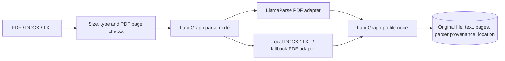
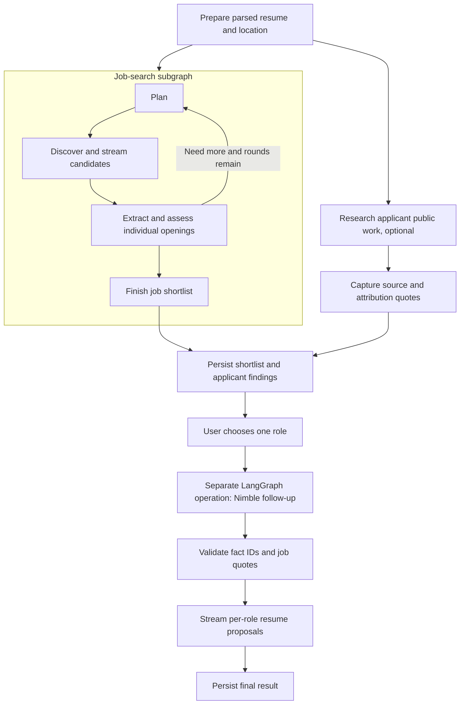

# System design

Proof has three LangGraph workflows: resume ingestion, research, and selected-role tailoring. React renders the workspace; the Next.js server proxies API requests and hosts the CopilotKit runtime; FastAPI owns operations. Original uploads live in local files; SQLite stores parsed text, metadata, results, and ordered events. CopilotKit observes the existing search over AG-UI. It does not start a competing agent.

## Ingestion

`ResumeParser` is a provider-neutral port. `RoutedResumeParser` selects LlamaParse for PDFs when a key is configured; TXT and DOCX remain local. LlamaParse uses the documented v2 multipart upload, polls the parse job, and requests only page Markdown. The agentic tier handles layout and OCR; its version is pinned in settings. Creation occurs once. A configured cloud failure is surfaced, not silently converted into a lower-quality local success.

Limits are 3 MB and ten PDF pages, checked before transmission. Encrypted/malformed PDFs fail locally. Upload parsing runs in a thread pool so cloud polling does not block the FastAPI event loop. Original bytes, cleaned text, page output, parse job ID/version, and extracted profile are saved together. Existing databases receive an additive metadata-column migration.

The location recognizer uses an offline place-name dataset and conservative header rules. It stops at work-history/education sections, prioritizes a location label, and avoids treating names or a prose mention as residence. Explicit geographic preferences override it; “anywhere” suppresses the default. “Remote” alone does not erase the need to establish an eligible hiring location. Unknown remains unknown. This is a heuristic, not a geocoder or a work-authorization decision.

## Parallel research graph

The entire job-search subgraph is one parent branch. Putting a long applicant node beside only the first planning node would make LangGraph’s superstep barrier delay discovery. The nested graph prevents that: a regression test synchronizes both branches and proves discovery runs before applicant research completes.

Applicant research runs once per search when the user supplies professional identity URLs. These are starting points, not a domain allowlist. Nimble can investigate linked projects, contributions, talks, articles, and corroborating professional sources. It is instructed to resolve identity and personal contribution, exclude private-life/sensitive-attribute research, and distinguish individual work from team achievements.

Returned facts require a public HTTPS source, a source quote, an attribution quote, and the provider’s explicit identity decision. Nimble Extract recaptures each cited page; both quotations must appear in that page. Unreadable sources or invented quotations do not become resume evidence. Matching a quote does not prove the attribution is correct, so the applicant still confirms it.

Job research is independent and streams first. The join saves both results. Only a user request to `POST /api/searches/{id}/tailor` delegates a role-specific connection task to Nimble for the selected match/review role, using the role, captured job passages, original resume context, and source-checked public facts. Output references local job IDs and fact IDs. A proposed addition must have a valid fact and an exact captured job quote. Remaining gaps stay explicit. Proposals do not automatically change match status. The follow-up uses the applicant agent’s `previous_interaction_id` when returned by Nimble, keeping context scoped to this applicant. A completed proposal is reused on repeated requests; it is not regenerated automatically.

`POST /api/searches/{id}/resume-draft` accepts selected proposal indexes for one role and returns the original parsed resume plus those additions as Markdown. It cannot accept arbitrary model text or unknown proposal indexes. The UI requires an attribution/wording confirmation for each addition. Neither the original file nor stored resume text is overwritten.

## Discovery and decisions

The local planner keeps a role prominent rather than stacking every skill into one query. It searches employer ATS pages first, then broadens discovery in a second round without relaxing requirements. A resume-derived location becomes “work in or remotely from…”; an explicit location preference takes precedence.

A Search result is only a candidate. It emits `candidate_discovered` immediately, before Extract or Agent assessment. Known directory shapes and captured career-index headings are followed through relevant individual employer/ATS links; those links come from captured Markdown, never invented URLs. Recursive depth and total follow-up fan-out are bounded to prevent loops and duplicate paid work. The directory itself never qualifies as an opening.

Each opening is extracted and investigated by Nimble. Local validation requires a specific opening, an employer/ATS host, usable listing identity, grounded resume/listing strengths, and evidence for requested constraints. Conflicts exclude. Missing region, availability, or other required evidence sends a role to Needs review. With public-work research enabled, otherwise valid openings lacking resume evidence can remain in review for the additional research; no unsupported claim is promoted to a confirmed match.

Source HTTP errors are reported explicitly. Retrieval/research failures are presented as Unverified, not lack of professional fit. Existing persisted `provider_error` exclusions receive the same presentation without rewriting their original traces. A completed run containing these failures is labelled “some pages unverified.”

The passage selector scans at most 120,000 characters and retains bounded verbatim slices and offsets. Input packing fits the provider’s 10,000-character constraint without cutting serialized JSON. The planner, selector, host checks, and exact-text checks are application policy; model interpretations and provider confidence remain separately inspectable.

## Replaceable components

| Component | Boundary | Wiring |
| --- | --- | --- |
| PDF parser | `ResumeParser.parse(filename, bytes)` | `composition.ingest_resume`; standalone LlamaParse and local adapters |
| Search / page capture / reasoning | `SearchProvider`, `ExtractProvider`, `Reasoner` | Separate adapters selected in `composition.build_services` |
| Research runtime | `WorkflowRunner.run(workflow, state)` | LangGraph owns graphs; workflow methods own domain decisions |
| Browser data access | `SearchRepository` | HTTP adapter; views consume typed records |
| Event delivery | `SearchSession` | CopilotKit/AG-UI by default; native SSE alternative |
| Access / hosting | Server access adapter and backend URL | React components and Python API remain independent |

All three Nimble APIs share one HTTP client. Agent creation is never automatically retried. High effort is the configured default for structured research; polling and public progress are separate from result retrieval. No hidden reasoning is requested or fabricated. The LlamaParse integration uses HTTPX and the official v2 REST contract, not a vector store or an additional LLM runtime.

## Events and UI

Upload can return an SSE response containing actual `parse`/`profile` node spans and LlamaParse job status. The same events are stored as ingestion provenance. A subsequent search emits `saved_ingestion`, explicitly labelled reused, instead of claiming another parse call occurred.

Actual LangGraph node invocation boundaries emit `node_started`, `node_completed`, and `node_failed` with span IDs, parent IDs, timestamps, durations, and allowlisted state summaries. This is application instrumentation around executed graph nodes, not a LangSmith account or a reconstruction of hidden reasoning.

Every persisted event has type, stage, timestamp, safe inputs/outputs, and a local candidate identity where applicable. Job and applicant branches can emit concurrently. SQLite sequence numbers establish replay order; the browser deduplicates by sequence.

| Event | Presentation |
| --- | --- |
| `node_started`, `node_completed`, `node_failed` | Actual graph/node, parent span, status, timing, safe input/output summaries |
| `plan_ready` | Actual queries, requirements, and selected location |
| `candidate_discovered` | A Checking card with an unverified source title/URL |
| `tool_started`, `provider_*` | Recorded call status and provider public progress |
| `job_matched`, `job_unknown` | Replace candidate with an evidence-backed role card |
| `job_excluded` | Genuine exclusion, or Unverified for a provider failure |
| `profile_research_completed` | Source-checked public-work findings and research provenance |
| `resume_proposals_ready` | Role-specific suggestions in the evidence drawer |
| `run_stopped`, `run_failed`, `search_completed` | Terminal state with received results retained |

The AG-UI observer in `api/agent.py` reads persisted events and forwards them as `proof.activity`, plus tool calls/results and run snapshots. `server/copilot.ts` connects that observer to the Next.js CopilotKit runtime, and `ui/adapters/CopilotConnection.tsx` subscribes from React. Observing, refreshing, and reconnecting never create another search. Native SSE uses the same records and views. State is read before the final event fetch to avoid dropping the last events during completion. Upload parsing progress uses its own SSE response through the Next.js API proxy, before a search exists.

Activity is opt-in beneath the status row, with no preloaded stages. Job cards appear while research continues. Candidate sources are explicitly unverified; they do not show fake fit checks. Source failures remain actionable links. React keys preserve open evidence while other results arrive. The native dialog manages keyboard focus and Escape; focus returns to its opener.

## Cancellation and persistence

One search runs per Python server. Opening assessments run with two workers; the optional applicant branch is independent; only a selected role triggers a later tailoring operation. The requested result count and settings bound discovery fan-out and rounds. Nimble can research beyond starting sources inside each task.

Stop signals a shared cancellation token before queued work, new calls, retries, and polling. In-flight HTTP requests must return before local stopping completes. Already-accepted remote Nimble tasks may continue. The stopped result preserves matches, review items, applicant findings, and proposals already emitted. Closing an observer does not cancel the worker.

Uploaded files, parsed metadata, SQLite, events, and derived evidence persist locally with owner-only file permissions. Removing a resume deletes its file, text, and parse metadata, while earlier searches keep selected quotations. No credentials or full resume inputs are emitted into traces. Full PDF bytes are transmitted to LlamaParse when configured; selected professional resume context and supplied professional links go to Nimble.

## Hosted workspace

The app opens without sign-in or a password. Next.js assigns a random 256-bit capability in an HttpOnly, SameSite=Strict cookie, Secure on HTTPS, valid for 30 days. The server hashes it into a browser workspace ID and forwards that ID to the loopback API. Client-supplied scope headers are not forwarded. The configured external origin remains authoritative and API bodies are bounded before proxying.

SQLite associates each resume with its workspace. Search history, results, events, exports, stop requests, and tailoring use the same ownership boundary. That association remains when a resume is deleted so its existing search history stays in the correct workspace. CopilotKit identifies each browser separately and forwards the same scope to the AG-UI observer.

This provides browser workspaces, not accounts: losing the cookie loses browser access to that history, and run URLs alone cannot share it. Earlier shared uploads and runs remain in the local-only workspace after migration; new public visitors do not inherit them. Data is retained on disk rather than erased when a cookie expires. Anyone visiting the public app can start research using the configured provider quota; the existing single-worker concurrency and request-size limits still apply.

The Docker image contains standalone Next.js and Python. The hosted launcher binds the UI to the host-provided `PORT`, leaves Python on loopback, forwards shutdown signals, and exits if either child exits. `/api/health` checks the Python service and SQLite. Run one instance with persistent storage and supply environment secrets through the hosting service.

Active searches become interrupted after a restart; the workflow is not checkpointed for automatic paid-task resumption. Automatic deploys remain off, and disk-backed deploys briefly interrupt the service. Multi-instance hosting would require an external database and work queue.
